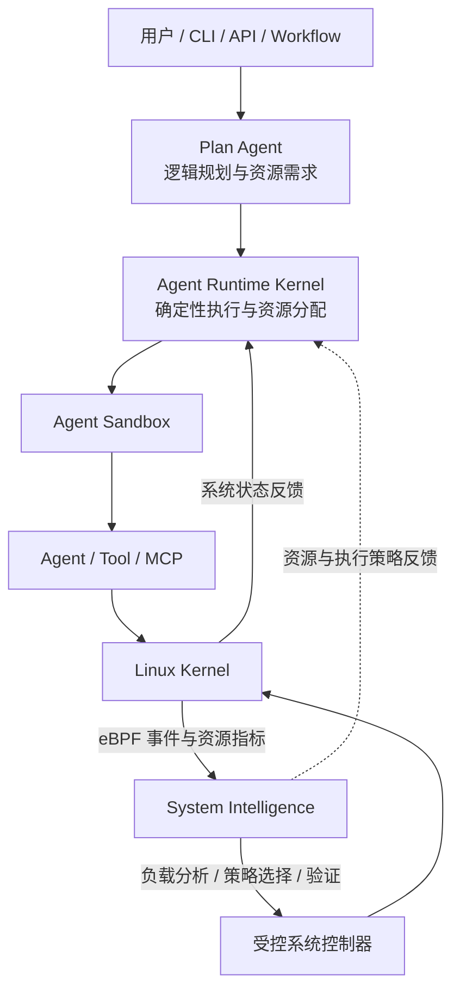

# trimum — AI-native System Runtime

> **把 AI Agent 纳入操作系统级的资源与安全体系。**
> trimum 不是 AI 桌面助手、Agent 框架或 Linux 发行版，而是一套连接 AI Agent 与操作系统的运行基础设施。

---

## 是什么

trimum 是纯 Python 实现的 **AI-native System Runtime**。它要解决的核心问题不是「再做一个 Agent」，
而是：**当 AI Agent 成为系统上的常规工作负载之后，操作系统如何管理它、约束它、观察它，并根据运行反馈调整它。**

trimum 的技术主线收敛为两个相互关联的方向：

1. **Agent Runtime** —— 管理 AI 工作负载：规划、调度、沙箱、上下文、资源预算、工具与 MCP、存储。
2. **System Intelligence** —— 理解并优化系统：eBPF 观测、负载分析、策略仓库、策略选择、执行验证、受控下发。

两者通过**资源管理、安全治理和系统反馈**形成闭环：



> 这不是单向调用链，而是「执行 → 观测 → 分析 → 受控调整 → 再执行」的双向控制闭环。

---

## 两个核心方向

### 1. Agent Runtime

Agent Runtime 是面向 AI Agent 的统一运行时基础设施。逻辑上分为：

- **Plan Agent**：理解任务、拆分流程、选择 Agent、提出资源需求；是逻辑决策中枢，**不直接持有系统最高权限**。
- **Agent Runtime Kernel**：把计划变成受控执行，负责 Agent Scheduler、Sandbox Manager、Context Manager、
  Resource Manager、Tool Manager、MCP Manager、Storage Manager。
- **Agent 执行模型**：`用户任务 → Plan Agent → Agent Runtime Kernel → Agent Sandbox → Agent → Tool / MCP`。
  Agent 不应绕过 Runtime 获得系统权限。

### 2. System Intelligence

System Intelligence 让 AI 不只是「调用系统接口」，而是能在安全约束下理解系统状态、辅助优化系统：

- **eBPF Observation / Enforcement**：观测 CPU / 内存 / IO、进程行为、系统调用、网络、Agent 与 Tool 执行行为；
  在受控前提下参与资源与安全策略执行。
- **Workload Analysis Engine**：识别工作负载类型、资源竞争与性能瓶颈。
- **Policy Repository**：沉淀调度策略、eBPF 程序、适用条件、历史结果与性能数据。
- **Policy Engine**：优先复用已有策略，必要时调整、组合或生成新策略。
- **Execution Verifier**：静态分析、运行前验证、隔离测试、性能基准、异常熔断与回滚。
- **Privileged Controller**：由受控用户态特权组件执行有限、经过授权的系统操作。

**边界**：LLM 推理不进入内核执行路径；AI 分析与策略决策全部在用户态完成。

---

## 设计原则

| 原则 | 含义 |
|---|---|
| **Lightweight** | 极致轻量，避免常驻无用进程。 |
| **On-demand** | Agent、Tool、Workflow 按需启动。 |
| **Least Privilege** | 最小权限；Plan Agent 不拥有系统最高权限。 |
| **Isolation** | Agent 与 Tool 的执行环境隔离。 |
| **Observability** | 系统行为、Agent 行为与策略执行可观测。 |
| **Verifiability** | 关键执行行为和策略可验证。 |
| **Feedback-driven** | 用运行反馈优化资源与执行策略。 |
| **Modular** | 模块化，但避免过度拆分。 |
| **Local-first** | 优先本地运行，减少不必要的数据外传。 |
| **Fail-safe** | AI 决策失败时，系统仍保持安全和可控。 |

---

## 当前实现状态

trimum 已有可运行的 Agent Runtime 主体；System Intelligence 目前以 **eBPF 观测**为主，
分析与策略闭环属于在建/未来设计。文档中不会把规划写成已实现能力。

| 能力 | 状态 | 主要落点 |
|---|---|---|
| Agent 生命周期、注册、启动、IPC | ✅ 已实现 | `agent_manager.py` / `agent_runtime.py` / `agent_launcher.py` / `agent_socket.py` |
| Agent 沙箱（Landlock / seccomp / cgroup） | ✅ 已实现 | `sandbox_exec.py` / `seccomp_exec.py` / `resource_controller.py` |
| Tool Gateway、策略、审批、审计 | ✅ 已实现 | `tool_gateway.py` / `policy_engine.py` / `approvals.py` / `audit_store.py` |
| Context / Memory / 上下文压缩 | ✅ 已实现 | `context_manager.py` / `context_compactor.py` / `memory_bridge.py` |
| Workflow / Event Bus / TARL | ✅ 已实现 | `workflow_runtime.py` / `event_bus.py` / `tarl_parser.py` |
| MCP 客户端、注册、工具聚合 | ✅ 已实现 | `mcp_client.py` / `mcp_registry.py` / `mcp_bridge.py` |
| eBPF 观测（helper + loader + 审计回灌） | ✅ 已实现 | `bpf_helper*.py` / `bpf_loader.py` / `bpf_audit.py` / `bpf/*.bpf.c` |
| 统一 Agent Runtime Kernel 门面 | 🟡 逻辑职责已具备，统一对象/接口 TBD | `docs/architecture/agent-runtime.md` |
| Workload Analysis Engine | ⚪ 未来设计 | `docs/architecture/system-intelligence.md` |
| Policy Repository / Policy Engine | ⚪ 未来设计 | `docs/architecture/system-intelligence.md` |
| Execution Verifier 完整链路 | 🟡 已有内核 verifier、sha256、沙箱；静态分析/基准/回滚 TBD | `docs/architecture/system-intelligence.md` |
| BPF LSM / sched_ext 强制执行 | ⚪ 未来设计 | `docs/architecture/system-intelligence.md` |

---

## 快速开始

安装后使用 `trm` 命令。

```bash
trm version                   # 版本
trm health                    # 快速健康检查（不需要 daemon）
trm status                    # daemon / Agent / 资源状态

trm ask "查看 /tmp 下有哪些大文件"
trm ask -i                    # 交互式多轮对话
trm exec "ls -la"             # 经 Tool Gateway 执行命令

trm security status           # 安全策略状态
trm log tail                  # 运行日志
trm log --audit               # 结构化审计日志
trm daemon start|stop|restart
trm doctor                    # 环境与配置自检
```

更多命令、插件与 workflow 用法见 `docs/TOOL-DEVELOPER-GUIDE.md` 与 `docs/ARCH.md`。

---

## 文档地图

| 文档 | 内容 |
|---|---|
| `docs/ARCH.md` | **架构单一事实源**：总体定位、两大核心、模块归属、实现边界。 |
| `docs/architecture/agent-runtime.md` | Agent Runtime 详细设计：Plan Agent、Kernel、资源模型、安全治理。 |
| `docs/architecture/system-intelligence.md` | System Intelligence 详细设计：观测、分析、策略、验证、受控执行。 |
| `docs/ROADMAP.md` | 按新主线调整后的路线图与待决策项。 |
| `docs/SECURITY.md` | Agent Runtime 安全治理与弹性沙箱。 |
| `docs/SECURITY-DEFENSE-PLAN.md` | 纵深防御、威胁模型与安全响应链。 |
| `docs/SANDBOX-PLAN.md` | Landlock / seccomp / cgroup / eBPF helper 的机制事实与真机实测。 |
| `docs/SANDBOX-SCOPE.md` | 沙箱配置分层与权限交集。 |
| `docs/TARL-SPEC.md` | Agent / Workflow / 记忆之间的轻量上下文协议。 |
| `docs/MEMORY-ARCH.md` | 三重记忆与 Context Manager 细节。 |
| `docs/MCP-INTEGRATION-PLAN.md` | MCP 接入（可选扩展层 L1）。 |
| `docs/ECOSYSTEM-STRATEGY.md` | 生态四层 L0–L3（可选扩展，不是核心架构）。 |
| `docs/OPERATIONS.md` | 真机 / 隧道 / 代理等运维细节（本地私有，不入库）。 |
| `STATUS.md` / `TODO.md` | 进度与待办（本地私有，不入库）。 |

---

## 范围边界

**核心架构**：Agent Runtime、System Intelligence、两者的资源/安全/反馈闭环。

**可选扩展**：生态四层（环境清单、MCP、Agent Skills、workflow 目录）、编码智能体、
官方分发渠道、多用户边界。

**未来规划 / 暂不投入**：桌面美化与桌面环境、完整 Linux 发行版、大规模插件生态、
独立知识管理系统、独立自动化/系统 Agent、复杂 GUI 助手、大量外部 Agent 协议适配。

这些方向不会从历史中删除，但不再作为 trimum 的核心创新叙事。

---

## 许可

MIT License — Copyright (c) 2026 guzhu jushi
