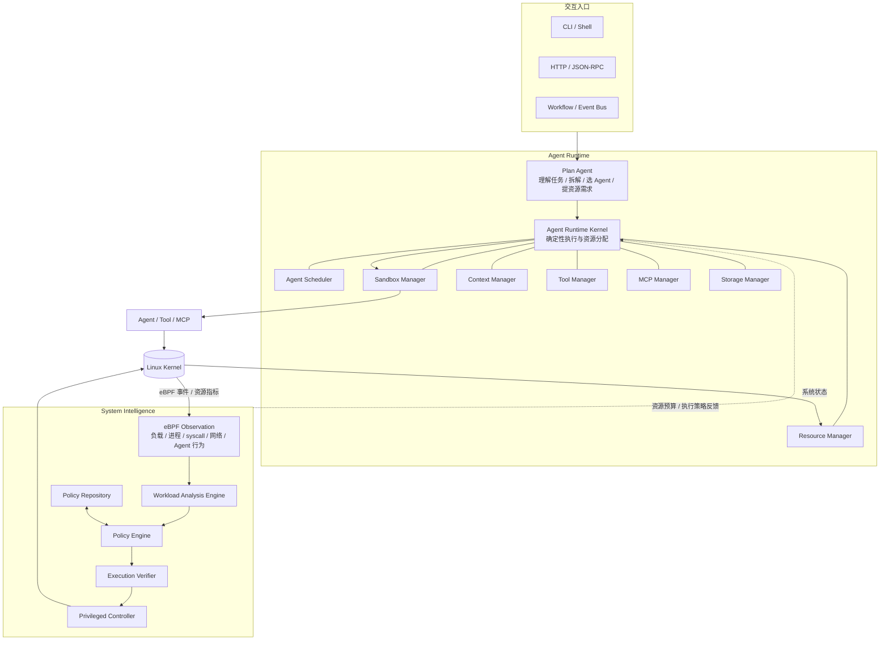
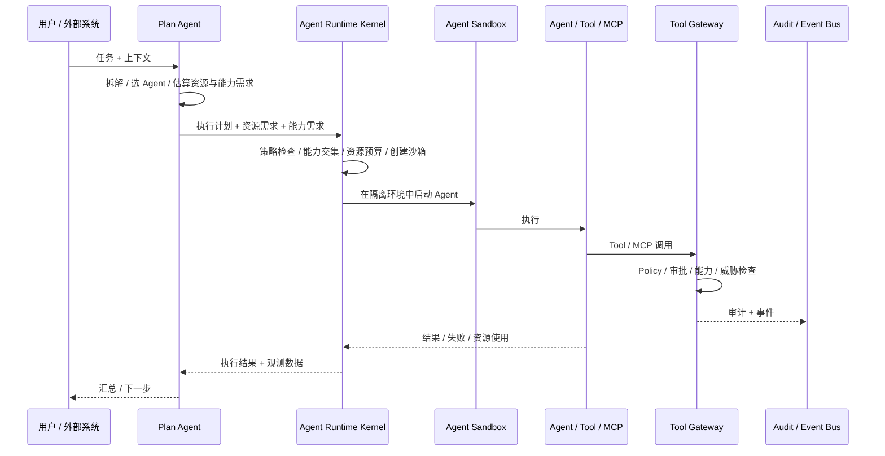
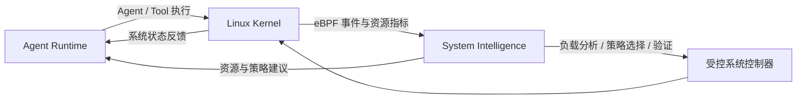

# ARCH — trimum 架构

> **架构单一事实源**（2026-11-11 重构）。
> 本文只回答「trimum 是什么、由哪两大核心组成、现有模块归属哪里、哪些已实现、哪些仍是 TBD」。
> 文件名沿用 `docs/ARCH.md`，不另建重复的 `ARCHITECTURE.md`。
> 详细设计：`docs/architecture/agent-runtime.md`、`docs/architecture/system-intelligence.md`、`docs/architecture/code-reuse.md`；
> 路线图：`docs/ROADMAP.md`；安全机制：`docs/SECURITY.md`、`docs/SECURITY-DEFENSE-PLAN.md`、`docs/SANDBOX-PLAN.md`。

**状态记号**：✅ 已实现　🟡 部分实现 / 原型　⚪ 未来设计（TBD）　🚫 已废弃 / 不再采用

---

## 0. 定位

trimum 是 **AI-native System Runtime（AI 原生系统运行环境）**。

它不是在做一个 AI 桌面助手、Agent 框架或 Linux 发行版，而是在建立一套连接 AI Agent 与操作系统的运行基础设施：

- 把 Agent 纳入统一的操作系统资源管理和安全控制体系。
- 让操作系统能够感知 AI 工作负载，并根据系统状态动态调整资源分配和执行策略。
- 建立 **Agent Runtime** 与 **System Intelligence** 之间的双向反馈机制。

一句话：

> **Agent Runtime 管理 AI 工作负载；System Intelligence 理解和优化整个操作系统的运行；
> 两者通过资源管理、安全治理和系统反馈形成闭环。**

---

## 1. 总体架构

架构上分三层，但**不要求拆成独立服务或进程**：

1. **交互层**：CLI、HTTP / JSON-RPC、Workflow 与 Event Bus。它是「人 / 外部系统」进入 Agent Runtime 的接口。
2. **Agent Runtime 层**：Plan Agent + Runtime Kernel。所有 Agent / Tool / MCP 的执行都必须经过这里。
3. **System Intelligence 层**：观测、分析、策略、验证、受控下发。它既读内核状态，也向内核提交经过验证的有限操作。

---

## 2. 设计原则

以下原则是架构裁决依据，不是宣传语：

1. **Lightweight**：极致轻量，避免常驻无用进程。
2. **On-demand**：Agent、Tool、Workflow 按需启动。
3. **Least Privilege**：最小权限；Plan Agent 不拥有系统最高权限。
4. **Isolation**：Agent 与 Tool 执行环境隔离。
5. **Observability**：系统行为可观测。
6. **Verifiability**：关键执行行为和策略可验证。
7. **Feedback-driven**：通过运行反馈优化资源和执行策略。
8. **Modular**：模块化，但避免过度拆分。
9. **Local-first**：优先本地运行，减少不必要的数据外传。
10. **Fail-safe**：AI 决策失败时，系统仍应保持安全和可控。
11. **Reuse-first**：优先复用成熟实现；许可证、权限模型和依赖成本都可接受时才引入。
12. **No dependency bloat**：核心保持纯 Python；外部工具按需、可选，不默认启动。

由这些原则派生出的硬约束：

- **Plan Agent 只提计划与资源需求**，不直接做权限检查、沙箱创建、进程管理。
- **Agent 不绕过 Runtime 获得系统权限**；所有动作经 Tool Gateway 与沙箱。
- **LLM 推理不进入内核执行路径**；AI 分析与策略决策在用户态完成。
- **未实现的能力不写成已实现**；不确定的实现细节标记 TBD 或 Future Design。
- **配置优先**：路径 / 端口 / 阈值按「显式参数 > 环境变量 > 配置文件 > 默认值」解析，缺失或坏值静默走默认。
- **复用不绕过安全边界**：第三方组件仍须经过 Tool Gateway、沙箱、最小权限与审计。
- **许可证可追溯**：项目采用 GPL-2.0-only；引入第三方代码必须兼容并保留来源与许可证。

---

## 3. 核心一：Agent Runtime

### 3.1 Plan Agent

Plan Agent 是 Agent 系统的逻辑规划和调度中枢，负责：

- 理解用户任务。
- 拆分任务并规划执行流程。
- 选择和调度合适的 Agent。
- 为 Agent 提出资源需求。
- 决定需要分配哪些 Tool 和 MCP。
- 管理任务执行过程和上下文协作。

**权限边界**：Plan Agent 是逻辑决策中枢，不是底层资源管理器，也不拥有系统最高权限。
它输出「执行计划 + 资源需求 + 能力需求」，实际资源分配、权限检查、沙箱创建和进程管理由
Agent Runtime 的确定性组件执行。

当前实现：`planner_agent.py`、`transform_agent.py`、`workflow_runtime.py`、`delegation.py` 已承担部分规划/
委派职责；**统一 Plan Agent 契约已裁决 B（版本化 schema），实现仍待拆单**。

**已裁决（2026-11-11）**：Plan Agent 输出采用 **版本化 schema（B）**，包含任务、步骤、资源需求、
沙箱范围、上下文命名空间、工具能力与审批声明；TARL 只携带引用与摘要。完整字段见
`docs/architecture/agent-runtime.md` §3.4。

### 3.2 Agent Runtime Kernel

Kernel 是「把计划变成受控执行」的确定性管理层。逻辑职责如下：

| 组件 | 职责 | 当前落点 | 状态 |
|---|---|---|---|
| **Agent Scheduler** | Agent 调度、生命周期、启动/停止、注册与 IPC | `agent_manager.py` / `agent_runtime.py` / `agent_launcher.py` / `agent_socket.py` / `agent_registry.py` | ✅ |
| **Sandbox Manager** | 沙箱创建、隔离、销毁；Landlock / seccomp / cgroup 施加 | `sandbox_exec.py` / `seccomp_exec.py` / `sandbox_limits.py` / `sandbox_state.py` | ✅ |
| **Context Manager** | 上下文分配、压缩、记忆命名空间与召回 | `context_manager.py` / `context_compactor.py` / `memory_bridge.py` / `memory_classifier.py` | ✅ |
| **Resource Manager** | CPU / RAM / IO / 文件写入 / 网络请求预算；cgroup 与 token 计量 | `resource_controller.py`（`CgroupV2Controller` / `PsutilController` / `TokenUsageTracker`） | 🟡 无 GPU 预算；系统级竞争调度 TBD |
| **Tool Manager** | 工具注册、发现、授权、调用、审计 | `tool_gateway.py` / `tool_dispatchers.py` / `tool_file_loader.py` / `capability.py` | ✅ |
| **MCP Manager** | MCP Server 管理、连接、工具聚合与权限分配 | `mcp_client.py` / `mcp_registry.py` / `mcp_bridge.py` / `mcp_catalog.py` | ✅ |
| **Storage Manager** | Agent 工作区、持久化存储、执行产物 | `paths.py` + 现有目录约定；**无统一 Storage Manager 对象** | 🟡 已裁决 B（统一 API + 配额），待实现 |

**Kernel 的形态**：当前这些模块是**逻辑职责划分**，不是一个叫 `RuntimeKernel` 的类。
**已裁决（2026-11-11）：B 薄门面** —— 引入统一入口与请求/响应 schema，但内部模块不拆不改，
也不要求立即拆成独立服务或进程。门面的职责与接口见 `docs/architecture/agent-runtime.md` §4.0。

### 3.3 Agent 执行模型

关键规则：

- **单一执行通道**：Agent / Workflow / CLI 的工具调用统一走 Tool Gateway，不新增绕过通道。
- **先交集后执行**：子 Agent 的能力、风险、预算、沙箱范围取父级与请求的交集，只收紧不放宽。
- **失败不伪装**：策略拒绝、沙箱施加失败、验证失败必须显式失败，不许静默降级。
- **执行可审计**：关键动作落审计链；观测失败不得让业务失败（审计/观测是旁路）。

### 3.4 资源管理层次

必须区分四个层次，不能把「Agent 预算」和「系统调度」混为一谈：

| 层次 | 管什么 | 当前状态 |
|---|---|---|
| **Agent 级预算** | 单个 Agent 的 CPU / RAM / IO / 写入 / 网络请求 / token | ✅ cgroup + `ResourceLimits` + `TokenUsageTracker` |
| **Workflow 级预算** | 一次 workflow 的总步数、token、并发与资源上限 | 🟡 部分（`delegation.Budget` 只管父子委派） |
| **Tool Call 级预算** | 单次工具调用的超时、输出大小、风险等级 | ✅ Tool Gateway / dispatcher 层 |
| **系统级竞争与调度** | 全局 CPU / 内存压力、Agent 间竞争、动态调整 | ⚪ System Intelligence 的 Future Design |

同时必须区分这些「资源」概念，不能混用：

- **Context**：当前模型上下文窗口内的 token。
- **RAM**：进程常驻内存。
- **Persistent Memory**：跨会话保存的记忆（SQLite / FTS5 / 未来向量索引）。
- **Storage**：工作区、产物、缓存、日志、审计文件。
- **CPU**：时间片与 cgroup 配额。
- **GPU**：当前未纳入预算模型（⚪ TBD）。
- **Token Budget**：LLM 输入/输出 token 配额，与 RAM/CPU 无关。

### 3.5 安全治理

安全是 Agent Runtime 的基础能力，不是外挂：

- 最小权限原则。
- 沙箱隔离（Landlock / seccomp / cgroup；namespace 视场景使用）。
- Tool / MCP 白名单与能力交集。
- 文件系统访问控制。
- 网络访问控制（受控范围内）。
- 高风险操作审批（交互 confirm；非交互 fail-closed + `trm approve`）。
- 资源限制。
- 执行日志、审计链与带外见证。

**实现边界**：Landlock、seccomp、cgroup 已有落地；BPF LSM、sched_ext 仍属 System Intelligence 的未来设计，
不得把它们写成已实现能力。机制事实以 `docs/SANDBOX-PLAN.md` 为准，配置口径以 `docs/SANDBOX-SCOPE.md` 为准。

### 3.6 交互入口

CLI / Shell / HTTP / JSON-RPC / Workflow 是「系统级 AI 的交互接口」，不是第三套运行时：

- CLI 通过 IPC 或 HTTP 调 daemon；daemon 内仍走同一套 Kernel / Gateway。
- Workflow 是 Agent Runtime 的编排层，不是独立执行通道。
- 桌面 / GUI 若存在，只是可选前端；不属于核心架构。

---

## 4. 核心二：System Intelligence

System Intelligence 的目标：让 AI 不只是调用操作系统接口，而是能理解系统运行状态，并在安全约束下辅助优化操作系统。

### 4.1 eBPF Observation / Enforcement

eBPF 是 System Intelligence 的重要基础设施，分两个方向：

**Observation（当前主线，✅ 部分实现）**

- CPU、内存、IO 负载（`system_monitor.py` + cgroup 指标）。
- 进程与线程行为。
- 系统调用和资源访问（`bpf_guard.bpf.c` 观测 `sys_enter_bpf`，`exec_guard.bpf.c` 观测 `sys_enter_execve`）。
- 网络活动（规划中）。
- Agent 与 Tool 的执行行为（审计 / Event Bus / eBPF 事件）。
- 系统性能事件。

**Enforcement（受控、渐进）**

- cgroup 资源控制：✅ 已通过 `resource_controller.py` 落地。
- BPF LSM 安全策略：⚪ 未实现；目标 Linux 7.0，升级后先做能力检查与复用评估。
- sched_ext 调度机制：⚪ 未实现；目标 Linux 7.0，优先评估 AgentCgroup / SchedCP 等实现，不先自研内核调度器。
- 与其他内核控制接口协作：⚪ TBD。

**边界**：eBPF 不只是传感器，也可以参与受控的系统行为管理；但 **LLM 推理不得放入内核执行路径**。
AI 分析与策略决策在用户态完成，内核侧只执行经过验证的有限程序。

当前 eBPF 实现的完整链路：`bpf/*.bpf.c` → 特权 helper（`bpf_helper*.py`）→ `bpf_loader.py`（libbpf/ctypes）
→ ring buffer → `/run/trimum-bpf/bpf-alerts.jsonl` → `bpf_audit.py` → `security.ebpf_alert` 审计/事件。
helper 只接受 `bpf.load` / `bpf.unload` / `bpf.stats` / `bpf.tail` 四个动词，不提供命令面。

### 4.2 Workload Analysis Engine

负责：

- 收集和分析系统负载。
- 识别工作负载类型。
- 分析 Agent 和 Tool 的资源使用情况。
- 发现资源竞争和性能瓶颈。
- 为策略选择提供系统状态依据。

**状态：⚪ Future Design**。当前只有 `system_monitor.py`（阈值告警）、`resource_controller.py`（用量采样）
与 `behavior_monitor.py`（安全行为基线）这几块「原材料」，还没有统一的工作负载分类/瓶颈分析引擎。

**已裁决（2026-11-11）：A 规则 / 阈值优先**。trimum 定位是个人 AI 工作站，不做多租户高并发；
分析层复用 AgentCgroup / SchedCP / AgentSight 的指标与事件设计，但不把其运行时整体嵌入。
目标内核基线为 Linux 7.0；升级后先跑能力自检，再决定哪些复用进入主线。详见 `docs/architecture/code-reuse.md`。

### 4.3 Policy Repository

系统策略仓库，计划沉淀：

- 已有调度策略。
- eBPF 程序和调度器。
- 工作负载特征。
- 策略适用条件。
- 历史执行结果。
- 性能测试数据。

**原则**：策略优化优先复用已有策略，而不是每次都让模型从零生成。
**状态：⚪ Future Design**。现有 `config/policy.yaml`、威胁剧本、eBPF 程序清单是**前身**，不是完整的策略仓库。
**已裁决（2026-11-11）：A Git 版本化 YAML**；不先上 SQLite，签名与淘汰机制待实现时细化。

### 4.4 Policy Engine

负责：

- 根据工作负载分析选择策略。
- 调整已有策略参数。
- 必要时修改或组合已有策略。
- 在适当情况下生成新策略。
- 根据系统反馈进行策略优化。

**状态：⚪ Future Design**。注意：现有 `policy_engine.py` 是 **Agent Runtime 的安全策略引擎**
（allow / confirm / deny），不是 System Intelligence 的调度策略引擎，两者不要混名。
**已裁决（2026-11-11）：策略生成 = B AI 提议 + 人工审批 + 强制验证**；不允许自动部署。

### 4.5 Execution Verifier

Execution Verifier 是 System Intelligence 的安全边界，负责：

- eBPF Verifier 检查。
- 静态分析。
- 运行前验证。
- 隔离环境测试。
- 性能基准测试。
- 部署前策略检查。
- 运行时监控。
- 异常熔断和策略回滚。

**硬约束**：AI 生成的内核策略绝不能未经验证直接部署。
**状态：🟡 部分实现**。当前已有内核 verifier、程序 sha256 清单校验、uid 门、沙箱隔离；
静态分析、基准测试、运行时熔断与自动回滚仍是 TBD。

### 4.6 Privileged Controller

负责将通过验证的策略部署到系统。AI 不直接拥有任意内核控制权限；应由受控的用户态特权组件执行有限的、
经过授权的系统操作。

**状态：🟡 部分实现**。当前 `trimum-bpf-helper` 是一个受限特权控制器，只做四个 eBPF 动词，
带 `CAP_BPF` + `CAP_PERFMON`、uid 校验、sha256 校验、只读程序目录；它不是通用内核控制接口。
**已裁决（2026-11-11）：C 先不拆**；不扩 helper、不另起 controller，人类审批顶着，最小权限不放松。
Linux 7.0 只打开 sched_ext / BPF LSM / memcg 的评估窗口；实际 capability 与加载权限必须先验证。

### 4.7 当前实现边界汇总

| 能力 | 状态 | 说明 |
|---|---|---|
| eBPF 观测链路（helper → loader → 审计回灌） | ✅ | 真机已跑通；只有观测，没有策略执行 |
| cgroup 资源控制 | ✅ | `CgroupV2Controller`；Agent 级预算 |
| 系统阈值告警 | ✅ | `SystemMonitor`；CPU / 内存 / 磁盘 / load |
| 工作负载分类 / 瓶颈分析 | ⚪ | 没有统一引擎；已定 A 规则优先 |
| 策略仓库 | ⚪ | 已定 A Git 版本化 YAML；待实现 |
| 调度策略选择 / 生成 | ⚪ | 没有实现 |
| 策略静态分析 / 基准 / 自动回滚 | ⚪ | 没有实现 |
| BPF LSM / sched_ext | ⚪ | 未实现；Linux 7.0 升级后做能力检查、复用评估与 PoC，不阻塞 MVP |
| 通用特权控制器 | ⚪ | 已定 C 冻结现状，人类审批顶着 |

---

## 5. 两个核心的闭环

Agent Runtime 与 System Intelligence 不是两个互不相关的系统。它们通过三个共同维度形成闭环：

### 5.1 资源管理

Agent Runtime 提出 Agent 和 Tool 的资源需求；System Intelligence 观察全局负载，分析资源竞争，辅助调整调度策略。

### 5.2 安全治理

Agent Runtime 管理 Agent 沙箱和工具权限；System Intelligence 观察实际系统行为，并通过受控机制执行系统级安全策略。

### 5.3 动态控制

Agent Runtime 管理 AI 工作负载；System Intelligence 根据系统状态反馈资源和执行策略；
Agent Runtime 根据反馈调整后续任务的资源需求和执行方式。

这不是严格的单向调用链，而是双向协作的控制闭环。

---

## 6. 现有模块 → 新架构归属

| 原有设计 / 模块 | 新归属 | 当前落点 | 状态 |
|---|---|---|---|
| Plan Agent | Agent Runtime | `planner_agent.py` / `transform_agent.py` | 🟡 |
| Agent Scheduler / Agent Pool | Agent Runtime Kernel | `agent_manager.py` / `agent_runtime.py` / `agent_launcher.py` | ✅ |
| Event Bus | Agent Runtime | `event_bus.py` / `event_index.py` | ✅ |
| Workflow Engine | Agent Runtime | `workflow_engine.py` / `workflow_runtime.py` / `workflow_listener.py` | ✅ |
| Agent Registry | Agent Runtime | `agent_registry.py` | ✅ |
| TARL | Agent Runtime（上下文协议） | `tarl_parser.py` | ✅ |
| Tool Gateway | Agent Runtime（Tool Manager） | `tool_gateway.py` / `tool_dispatchers.py` | ✅ |
| MCP 管理 | Agent Runtime（MCP Manager） | `mcp_client.py` / `mcp_registry.py` / `mcp_bridge.py` | ✅ |
| Context / Memory | Agent Runtime（Context Manager） | `context_manager.py` / `context_compactor.py` / `memory_bridge.py` | ✅ |
| Landlock / seccomp / cgroup | Agent Runtime 安全治理（Sandbox Manager） | `sandbox_exec.py` / `seccomp_exec.py` / `resource_controller.py` | ✅ |
| eBPF | System Intelligence | `bpf/` / `bpf_helper*.py` / `bpf_loader.py` / `bpf_audit.py` | 🟡 观测已实现，强制执行 TBD |
| Workload Analysis | System Intelligence | 无统一引擎 | ⚪ |
| Policy Repository | System Intelligence | 零散策略文件 | ⚪ |
| Execution Verifier | System Intelligence | 内核 verifier + sha256 + 沙箱 | 🟡 |
| Shell / 桌面交互入口 | 系统级 AI 的交互接口 | CLI / IPC / HTTP / Workflow | ✅ |

**注意**：以上是逻辑归属，不代表所有模块都必须独立部署。保留有价值的技术方案，
但不为了兼容旧架构而保留不必要的抽象。

---

## 7. 核心 / 可选扩展 / 未来规划 / 已废弃

### 7.1 核心架构

- Agent Runtime：Plan Agent、Runtime Kernel、沙箱、上下文、资源、工具、MCP、存储、Workflow。
- System Intelligence：eBPF 观测、工作负载分析、策略仓库、策略引擎、执行验证、受控执行。
- 两者的资源 / 安全 / 反馈闭环。

### 7.2 可选扩展

- 生态四层 L0–L3（环境清单、MCP、Agent Skills、workflow 目录）。
- 编码智能体（`trm exec --code`）。
- 官方分发渠道与包信任模型。
- 多用户边界。
- 浏览器工具、桌面 / GUI 前端。

这些能力仍有价值，但不是 trimum 的核心创新叙事；文档中应明确标注「可选扩展」。

### 7.3 未来规划

- Workload Analysis Engine、Policy Repository、Policy Engine。
- 策略静态分析、基准测试、自动回滚。
- BPF LSM、sched_ext 等受控强制执行；优先评估 AgentCgroup / SchedCP 等实现，能复用则复用，不能复用才自研。
- GPU 资源预算与系统级竞争调度。

### 7.4 已废弃 / 不再采用

- 把 trimum 做成「完整 Linux 发行版」。
- 以桌面美化和桌面环境作为核心卖点。
- 大规模插件生态 / 独立知识管理系统 / 独立系统 Agent 作为主线。
- 为兼容旧架构而保留的重复抽象（例如把每个逻辑职责都拆成独立常驻服务）。

历史设计不删除价值事实，但不再作为架构主线。

---

## 8. 文档地图与真源

| 主题 | 真源 |
|---|---|
| 总体架构 | 本文 |
| Agent Runtime 详细设计 | `docs/architecture/agent-runtime.md` |
| System Intelligence 详细设计 | `docs/architecture/system-intelligence.md` |
| 代码复用与许可证边界 | `docs/architecture/code-reuse.md` |
| 路线图 | `docs/ROADMAP.md` |
| 安全治理 | `docs/SECURITY.md`、`docs/SECURITY-DEFENSE-PLAN.md` |
| 沙箱机制 | `docs/SANDBOX-PLAN.md`、`docs/SANDBOX-SCOPE.md` |
| 上下文协议 | `docs/TARL-SPEC.md` |
| 记忆 | `docs/MEMORY-ARCH.md` |
| 工具开发 | `docs/TOOL-DEVELOPER-GUIDE.md` |
| MCP（可选扩展） | `docs/MCP-INTEGRATION-PLAN.md` |
| 生态四层（可选扩展） | `docs/ECOSYSTEM-STRATEGY.md` |
| 编码智能体（Agent Runtime 应用） | `docs/CODING-AGENT-PLAN.md` |
| 包渠道 / 分发 | `docs/PACKAGE-CHANNEL-OPS.md` |
| 多用户边界 | `docs/MULTI-USER-BOUNDARY.md` |
| 运维 | `docs/OPERATIONS.md`（本地私有，不入库） |
| 进度 / 待办 | `STATUS.md` / `TODO.md`（本地私有，不入库） |

---

## 9. 已裁决与剩余 TBD（2026-11-11）

### 9.1 已裁决

| 决策 | 结论 |
|---|---|
| 内核基线 | **Linux 7.0**（计划升级）；升级前 6.8 只作当前实测事实，不作为长期约束。 |
| 项目许可证 | **GPL-2.0-only**；从下一个发布版本起，历史版本仍为 MIT。 |
| 代码复用 | **复用优先**：AgentCgroup 第一优先；SchedCP / AgentSight 可选外部工具；ActPlane 只作设计参考；核心不引入 Rust 工具链或新常驻服务。 |
| RuntimeKernel 门面 | **B 薄门面**：统一入口与 schema，内部模块不拆不改。 |
| Plan Agent 输出契约 | **B 版本化 schema**：先冻结最小字段；TARL 只带引用与摘要。 |
| Storage Manager | **B 统一 API + 配额**：先接口与配额，不改现有路径语义。 |
| Workflow 级预算 | **B 独立 WorkflowBudget**：复用 tighten，与 Agent 预算取交集。 |
| EventBus 历史 | **B JSONL/WAL + 启动回放**：持久化失败不影响业务。 |
| 硬资源超限 | **A 硬拒绝 fail-closed**：CPU / RAM / 存储 / 文件写入。 |
| token / 成本超限 | **B pending 审批**：默认 10% 浮动，可配置。 |
| 成本视图 | **A 放在 `trm status` + `--json`**：不新增顶层命令。 |
| eBPF perf gate | **A 短期保持 `perf_event_paranoid=3`**；纯 `bpf(2)` 作后备设计。 |
| 审计链刷屏 | **先诊断**；确认良性后隔离旧链 + 新链；疑似篡改保留证据。 |
| Workload Analysis | **A 规则 / 阈值优先**；复用 AgentCgroup / SchedCP / AgentSight 的指标与事件设计，不整体嵌入其运行时。 |
| Policy Repository | **A Git 版本化 YAML**；不先上 SQLite。 |
| 策略生成 | **B AI 提议 + 人工审批 + 强制验证**。 |
| Privileged Controller | **C 先不拆**；人类审批顶着，最小权限不放松。 |
| 反馈闭环 | **暂缓**，等 R1 / R2 / R4 稳定。 |

### 9.2 剩余 TBD

1. **Plan schema 的字段冻结与兼容策略**：最小字段先定哪些，后续如何演进。
2. **StorageManager 的配额默认值与迁移顺序**。
3. **系统级调度接口**：System Intelligence 向 Agent Runtime 反馈的指标与建议格式。
4. **Execution Verifier 的验证等级**：哪些策略必须静态分析 + 基准 + 隔离测试。
5. **Linux 7.0 的实际能力与 PoC 准入**：sched_ext、BPF LSM、memcg_bpf_ops 是否可用，需升级后逐项验证。
6. **GPU / 网络 / 存储 IO 的预算模型**：当前未纳入或只有部分采样。
7. **多用户边界下的 Runtime 归属**：每用户 Runtime vs 系统 Runtime。
8. **AgentCgroup 许可证精确版本与 vendor 边界**：确认 `GPL-2.0-only` / `GPL-2.0-or-later`，确定可复用模块与来源记录。

---

## 10. 一句话总结

> trimum = **Agent Runtime（管理 AI 工作负载）** + **System Intelligence（理解并优化系统）**，
> 以资源、安全和反馈为共同维度，形成一个受控、可观测、可验证的 AI 原生系统运行环境。
