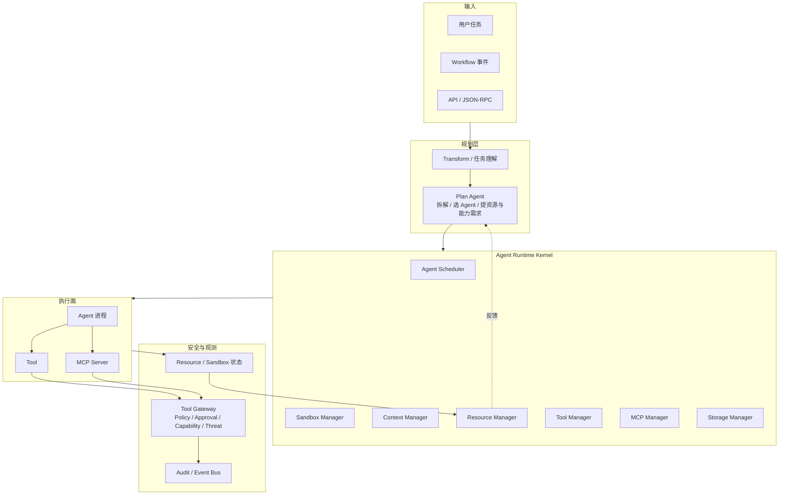

# Agent Runtime 详细设计

> 归属：`docs/ARCH.md` §3。
> 本文描述 Agent Runtime 的逻辑结构、职责边界、执行模型与当前实现映射；不规定必须拆成独立服务。
> 状态记号：✅ 已实现　🟡 部分实现　⚪ 未来设计（TBD）　🚫 已废弃

---

## 1. 目标

Agent Runtime 是面向 AI Agent 的统一运行时基础设施。它要保证：

- Agent 的任务规划与系统执行分离：**Plan Agent 做逻辑决策，Runtime Kernel 做确定性执行**。
- Agent 不能绕过 Runtime 直接获取系统权限。
- 每个 Agent 的能力、资源、沙箱范围都是**显式、可审计、可收紧**的。
- Agent / Tool / Workflow 按需启动，避免长期驻留浪费资源。
- 不同 Agent 之间可以协作，但默认隔离；跨 Agent 访问必须经过能力与策略检查。

---

## 2. 逻辑架构



---

## 3. Plan Agent

### 3.1 职责

- 理解用户任务。
- 拆分任务并规划执行流程。
- 选择和调度合适的 Agent。
- 为 Agent 提出资源需求。
- 决定需要分配哪些 Tool 和 MCP。
- 管理任务执行过程和上下文协作。

### 3.2 权限边界

Plan Agent **不是**底层资源管理器，也**不拥有系统最高权限**。它输出：

```text
执行计划（步骤 / 依赖 / 失败策略）
+ 资源需求（CPU / RAM / 存储 / Token / 超时）
+ 能力需求（Tool / MCP / 文件面 / 网络面 / 风险上限）
+ 上下文引用（项目 / Agent / 全局记忆）
```

实际执行由 Kernel 完成：

- 权限检查与能力交集。
- 沙箱创建与销毁。
- 进程启动 / 停止 / 回收。
- 资源预算与 cgroup 绑定。
- 工具调用与审计。

### 3.3 当前实现

| 能力 | 落点 | 状态 |
|---|---|---|
| 自然语言 → 结构化请求 | `transform_agent.py` / `tarl_parser.py` | ✅ |
| 规划 / 兜底规划 | `planner_agent.py` | 🟡 |
| 任务编排 | `workflow_runtime.py` / `workflow_engine.py` | ✅ |
| 父子委派与预算交集 | `delegation.py` | ✅ |
| 统一 Plan Agent schema | 无 | ⚪ TBD |

---

## 4. Agent Runtime Kernel

Kernel 是「把计划变成受控执行」的确定性组件集合。它不调用 LLM 做权限判断；LLM 只能在策略允许的范围内提供建议。

### 4.1 Agent Scheduler

职责：

- Agent 注册、发现、状态机与生命周期。
- 启动 / 停止 / 回收 Agent 进程。
- 分配 Agent ID、证书 / 身份、socket 与会话。
- 维护 Agent 与 Workflow / Task 的归属关系。

当前落点：

- `agent_registry.py`：Agent 定义与发现。
- `agent_manager.py` / `agent_runtime.py`：运行时状态与生命周期。
- `agent_launcher.py`：子进程启动、日志落盘、cgroup 绑定。
- `agent_socket.py`：Unix socket / JSON-RPC 帧协议。
- `delegation.py`：父子 Agent 能力 / 风险 / 预算交集。

状态：✅ 主体已实现；统一调度队列与系统级公平调度 ⚪ TBD。

### 4.2 Sandbox Manager

职责：

- 为 Agent / Tool 创建隔离执行环境。
- 施加 Landlock、seccomp、cgroup；必要时使用 namespace。
- 在失败时 fail-closed，不静默降级。
- 记录沙箱状态与施加结果，供审计与 `trm status` 使用。

当前落点：

- `sandbox_exec.py`：统一施加点 / spawn 收口。
- `seccomp_exec.py`：seccomp 档案。
- `sandbox_limits.py` / `sandbox_state.py`：限额与状态。
- `resource_controller.py`：cgroup v2 控制。

状态：✅ S1–S6 已落地（详见 `docs/SANDBOX-PLAN.md`）；namespace 组合与更强隔离档仍按场景评估。

### 4.3 Context Manager

职责：

- 为 Agent 分配上下文窗口与记忆命名空间。
- 压缩历史、保留关键步骤、控制 token 预算。
- 管理 Agent 私有记忆、项目共享上下文、全局上下文。
- 提供只读召回；写入走统一记忆桥与审计。

当前落点：

- `context_manager.py`：SQLite + FTS5 持久化。
- `context_compactor.py`：滑窗 / 摘要 / 预算。
- `memory_bridge.py` / `memory_classifier.py` / `memory_schema.py`：记忆桥与分类。
- `experience_learner.py`：经验学习（旁路）。
- `tarl_parser.py`：KV 行格式上下文协议。

状态：✅ 主体已实现；语义召回 / 向量检索属 Future Design（见 `docs/RAG-RESEARCH.md`）。

### 4.4 Resource Manager

职责：

- 维护 Agent 级资源预算：CPU、RAM、IO、文件写入、网络请求、token。
- 将预算绑定到 cgroup 或跨平台控制器。
- 采样用量，检测越限并发出事件。
- 向 Plan Agent / System Intelligence 提供资源使用反馈。

当前落点：

- `resource_controller.py`：`ResourceController` 抽象、`CgroupV2Controller`、`PsutilController`、`TokenUsageTracker`。
- `sandbox_limits.py`：沙箱限额。

状态：🟡 Agent 级预算已实现；Workflow 级预算部分；系统级竞争调度、GPU 预算 ⚪ TBD。

### 4.5 Tool Manager

职责：

- 工具注册、发现、启用 / 禁用。
- 统一调用入口与参数校验。
- 权限、风险、审批、能力交集、威胁检查。
- 输出脱敏与审计。

当前落点：

- `tool_gateway.py`：分层检查与决策合并。
- `tool_dispatchers.py`：原生 dispatcher。
- `tool_file_loader.py`：文件工具加载。
- `capability.py`：能力清单与安装信任。
- `policy_engine.py` / `security_rule.py` / `sec_monitor.py` / `approvals.py`：策略、威胁与审批。

状态：✅ 已实现。检查顺序与合并规则以代码与 `docs/SECURITY-DEFENSE-PLAN.md` 为准。

### 4.6 MCP Manager

职责：

- 管理 `~/.trimum/mcp/*.json5` 定义。
- 懒启动 / 复用 / 重建 MCP Server 连接。
- 聚合远端工具，登记到统一能力表。
- 让 MCP 工具与内置工具享受同一套策略与审计。

当前落点：

- `mcp_client.py`：stdio JSON-RPC 客户端。
- `mcp_registry.py`：定义、生命周期、连接池。
- `mcp_bridge.py`：远端工具聚合。
- `mcp_catalog.py`：策展目录导入。

状态：✅ M0–M4.5 已实现；详见 `docs/MCP-INTEGRATION-PLAN.md`（可选扩展层 L1）。

### 4.7 Storage Manager

职责（目标态）：

- Agent 工作区与持久化目录。
- 执行产物、缓存、日志、审计文件的配额与清理。
- 跨会话存储的生命周期。

当前状态：🟡 **没有统一 Storage Manager 对象**。现有事实是：

- 路径统一走 `paths.py`（`TRIMUM_HOME` / 数据目录 / 配置目录）。
- 记忆、审计、工具、Agent、workflow 各有目录约定。
- 配额与清理策略分散在模块内。

统一接口与配额模型属 R1 待决策项。

---

## 5. 执行模型

### 5.1 正常路径

```text
用户任务
  → Plan Agent：拆解、选 Agent、提资源/能力需求
  → Kernel：策略检查、能力交集、资源预算、沙箱创建
  → Agent Sandbox：启动 Agent
  → Agent：调用 Tool / MCP
  → Tool Gateway：Policy / Approval / Capability / Threat / Audit
  → 结果回流：Agent → Kernel → Plan Agent → 用户
```

### 5.2 失败路径

| 失败点 | 行为 |
|---|---|
| 计划不可执行 | 返回明确错误，不启动 Agent。 |
| 能力 / 风险 / 预算交集不成立 | 直接拒绝，不启动、不发事件。 |
| 沙箱施加失败 | fail-closed，拒绝执行并审计。 |
| 工具策略拒绝 / 需要审批 | 交互 confirm；非交互落 pending 并拒绝。 |
| 工具执行失败 | 返回结构化错误，不伪装成功。 |
| 审计 / 观测失败 | 只记日志，不让业务失败。 |

### 5.3 生命周期状态（逻辑）

```text
created → queued → dispatching → running → completed
                                      ├→ failed
                                      ├→ timeout
                                      ├→ cancelled
                                      └→ blocked（缺权限 / 待审批）
```

具体状态名以 `agent_runtime.py` / `models.py` 为准；本文只固定逻辑语义。

---

## 6. 资源模型

### 6.1 四个层次

| 层次 | 作用范围 | 控制方式 | 状态 |
|---|---|---|---|
| Agent 级 | 单个 Agent 进程 | cgroup / psutil / 内部计数器 | ✅ |
| Workflow 级 | 一次编排 | `delegation.Budget` / workflow 运行记录 | 🟡 |
| Tool Call 级 | 单次工具调用 | 超时、输出上限、风险等级 | ✅ |
| 系统级 | 全机 Agent 竞争 | System Intelligence 反馈调度 | ⚪ |

### 6.2 七类资源

| 资源 | 说明 | 不要与什么混淆 |
|---|---|---|
| Context | 当前模型窗口内的 token | 不是 Persistent Memory |
| RAM | 进程常驻内存 | 不是 Storage |
| Persistent Memory | 跨会话记忆 | 不是 Context |
| Storage | 工作区 / 产物 / 缓存 / 日志 | 不是 RAM |
| CPU | 时间片 / cgroup 配额 | 不是 Token Budget |
| GPU | 加速器配额 | 当前未纳入预算 |
| Token Budget | LLM 输入/输出 token | 不是 CPU / RAM |

---

## 7. 安全治理

### 7.1 分层

1. **Plan 层**：只提需求，不做权限裁决。
2. **Kernel 层**：能力交集、资源预算、沙箱创建、生命周期。
3. **Gateway 层**：Policy / Approval / Capability / Threat / Audit。
4. **OS 层**：Landlock / seccomp / cgroup / namespace / eBPF（观测或受控执行）。

### 7.2 硬约束

- **单一执行通道**：Tool / MCP / Workflow 不绕过 Tool Gateway。
- **先收紧后执行**：能力、风险、预算、沙箱范围取交集；交集不成立即拒绝。
- **非交互 fail-closed**：没有审批通道时，confirm 不得自动放行。
- **审计是旁路**：审计 / 观测失败不许让业务失败。
- **不静默降级**：沙箱施加失败、能力清单读不懂、策略异常，都必须显式失败或按更严档处理。

详细机制见 `docs/SECURITY.md`、`docs/SECURITY-DEFENSE-PLAN.md`、`docs/SANDBOX-PLAN.md`、`docs/SANDBOX-SCOPE.md`。

---

## 8. 与其他部分的关系

| 部分 | 关系 |
|---|---|
| System Intelligence | Runtime 提供执行上下文与资源使用数据；System Intelligence 返回资源/策略建议。 |
| Workflow | Workflow 是 Runtime 的编排层，不是独立执行通道。 |
| CLI / API | 交互接口；最终仍进入 Runtime。 |
| 生态四层 | 向 Runtime 提供 Tool / MCP / Skill / Workflow 能力，统一登记、默认不启用。 |
| 编码智能体 | Runtime 的一个应用形态，不是另一套运行时。 |

---

## 9. TBD / 待决策

1. 是否引入统一 `RuntimeKernel` 门面对象与统一请求/响应 schema。
2. Plan Agent 的输出契约与失败回退策略。
3. Storage Manager 的边界、配额与清理策略。
4. Workflow 级预算的正式模型。
5. 系统级调度接口：哪些指标、什么频率、如何反馈给 Plan Agent。
6. GPU / 网络 / 存储 IO 的预算与隔离。
7. 多用户边界下的 Runtime 归属（每用户 Runtime vs 系统 Runtime）。

---

## 10. 一句话

> Agent Runtime 的职责不是「让 Agent 更能干」，而是「让 Agent 的能力被安全、可控、可观测地执行」。
