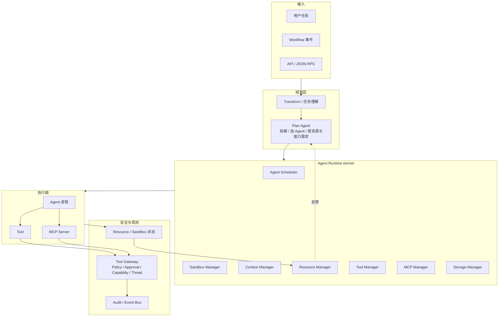

# Agent Runtime 详细设计

> 归属：`docs/ARCH.md` §3。
> 本文描述 Agent Runtime 的逻辑结构、职责边界、执行模型与当前实现映射；不规定必须拆成独立服务。
> 状态记号：✅ 已实现　🟡 部分实现　⚪ 未来设计（TBD）　🚫 已废弃

---

## 1. 目标

Agent Runtime 是面向 AI Agent 的统一运行时基础设施。它要保证：

- Agent 的任务规划与系统执行分离：**Plan Agent 做逻辑决策，Runtime Kernel 做确定性执行**。
- Agent 不能绕过 Runtime 直接获取系统权限。
- 每个 Agent 的能力、资源、沙箱范围都是**显式、可审计、可收紧**的。
- Agent / Tool / Workflow 按需启动，避免长期驻留浪费资源。
- 不同 Agent 之间可以协作，但默认隔离；跨 Agent 访问必须经过能力与策略检查。

---

## 2. 逻辑架构



---

## 3. Plan Agent

### 3.1 职责

- 理解用户任务。
- 拆分任务并规划执行流程。
- 选择和调度合适的 Agent。
- 为 Agent 提出资源需求。
- 决定需要分配哪些 Tool 和 MCP。
- 管理任务执行过程和上下文协作。

### 3.2 权限边界

Plan Agent **不是**底层资源管理器，也**不拥有系统最高权限**。它输出：

```text
执行计划（步骤 / 依赖 / 失败策略）
+ 资源需求（CPU / RAM / 存储 / Token / 超时）
+ 能力需求（Tool / MCP / 文件面 / 网络面 / 风险上限）
+ 上下文引用（项目 / Agent / 全局记忆）
```

实际执行由 Kernel 完成：

- 权限检查与能力交集。
- 沙箱创建与销毁。
- 进程启动 / 停止 / 回收。
- 资源预算与 cgroup 绑定。
- 工具调用与审计。

### 3.3 当前实现

| 能力 | 落点 | 状态 |
|---|---|---|
| 自然语言 → 结构化请求 | `transform_agent.py` / `tarl_parser.py` | ✅ |
| 规划 / 兜底规划 | `planner_agent.py` | 🟡 |
| 任务编排 | `workflow_runtime.py` / `workflow_engine.py` | ✅ |
| 父子委派与预算交集 | `delegation.py` | ✅ |
| 统一 Plan Agent schema | 契约已定（B 版本化 schema），实现待拆 | 🟡 |

### 3.4 Plan Agent 输出契约（2026-11-11 定：B 版本化 + A 最小冻结）

Plan Agent 不直接启动进程，也不直接分配资源；它输出一份**可验证的计划**，由 Kernel 校验后执行。
契约采用版本化 schema，先冻结最小字段，再逐步扩展（不追求一次设计完整）。

**冻结口径（A）**：`trimum.plan/v1` 的必填字段只有 `schema`、`plan_id`、`task`、`steps`，
以及每个 step 的 `id` / `agent` / `instruction` / `depends_on`；`resources`、`sandbox`、`context`、
`tools`、`approvals`、`on_failure` 先作为可选扩展。这样 Codex 先稳定产出，后续再收紧必填项。

建议的最小结构（示意，不是已冻结代码）：

```yaml
schema: trimum.plan/v1
plan_id: plan_20261111_001
task: "修复 nginx 502"

constraints:
  risk_max: medium          # low | medium | high | critical
  deadline_s: 600

steps:
  - id: inspect
    agent: shell
    depends_on: []
    instruction: "查看 nginx 错误日志"
    resources:
      cpu_percent_max: 80
      memory_mb_max: 512
      timeout_s: 60
      token_budget: 20000
      storage_mb: 256
      gpu: null             # 当前未纳入预算
    sandbox:
      mode: workspace-write # off | readonly | workspace-write | strict
      read: ["/srv/repo", "<TRIMUM_HOME>"]
      write: ["/srv/repo", "/tmp"]
      deny_write: ["/etc", "~/.ssh"]
      network: deny         # deny | allowlist（具体语法 TBD）
      seccomp: l1           # l1 | strict | off
    context:
      read: [project, agent]
      write: [agent]
      max_tokens: 12000
      tarl_handoff: true
    tools:
      allow: [shell, file]
      deny: [git.push]
    approvals:
      allow: []             # 非交互 confirm 的声明式放行
    on_failure: stop        # stop | retry | continue（策略 TBD）
```

**字段含义**

- `resources` / `sandbox` / `context` / `tools` / `approvals` / `on_failure`：v1 可选，后续版本再决定是否提升为必填。
- `resources`：Agent 级资源需求；实际分配由 Resource Manager 取交集，不能由 Plan Agent 直接放大。
- `sandbox`：沙箱范围（文件读写、网络、seccomp）；由 Sandbox Manager 施加，失败 fail-closed。
- `context`：上下文与记忆命名空间；由 Context Manager 分配，token 预算与压缩策略由它执行。
- `tools`：能力需求；由 Tool Manager 做白名单 / 能力交集 / 审批。
- `approvals`：非交互场景的声明式放行；未声明时保持 fail-closed。
- `on_failure`：失败语义；默认 `stop`，不允许静默成功。

**与 TARL 的关系**

TARL 是**紧凑传输格式**，schema 是**语义契约**；两者不是一回事：

- 完整计划以 schema 对象为准（JSON/YAML），可版本化、可校验、可回放。
- TARL 负责 Agent ↔ Workflow ↔ 记忆之间的轻量 handoff；推荐只携带**扁平引用 + 少量关键字段**，
  例如 `plan:id`、`step:id`、`sandbox:workspace-write`、`cpu:80`、`mem:512`、`ctx:project:foo`。
- 不建议把完整的嵌套 sandbox / context / policy 树塞进一行 TARL：键值行会迅速变长，转义与歧义成本高。
  需要完整策略时，用 `plan:id` 回查 schema 对象。

> 这与「Plan Agent 在 TARL 里带上沙箱、文件访问、上下文」的想法方向一致；区别是：
> **TARL 带的是引用与摘要，完整契约留在 schema 里**，这样既能保持 TARL 轻量，也能让 Kernel 做确定性校验。

### 3.5 Codex 作为 Plan Agent（2026-11-11 定）

**结论：可以复用 Codex 的内置提示词和完整 Agent 循环，但只能通过 `codex exec` 子进程复用；不复制、不 import、也不修改 Codex 源码。**

- `codex exec` 自带 Codex 的 system / developer prompt、工具循环、仓库读取、sandbox 与 approval 机制；trimum 只提供任务、边界、schema 和结果位置。
- `--output-schema` 只约束**最终响应**的结构，不替换 Codex 的内部流程。schema 校验失败视为本次计划失败，**不自动重试**。
- Plan 角色固定 `-s read-only`：可以读仓库、做只读检查，但不能写盘、不能跑会改状态的测试，也不能直接启动 coding 子 Agent。
- Codex 的版本、model/provider、profile 由 trimum 固定并记录；不假设“某个版本的内部 prompt 永远不变”。
- 复用的是 Codex 的运行时行为，不是可调用的库 API；最终验收仍由 trimum 的 `verifier.py` 做，不能把 Codex 自报的“测试通过”当结论。

建议调用形态：

```bash
codex exec \
  -s read-only \
  -C <workspace> \
  --skip-git-repo-check \
  --ephemeral \
  --output-schema schemas/trimum.plan.v1.json \
  --output-last-message <run_dir>/plan.json \
  -m <model> \
  "<plan prompt>"
```

**每次调用生成一份不可变 `CodexInvocation`**，至少包含：

```yaml
schema: trimum.codex_invocation/v1
role: plan | code | verify
plan_id: plan_20261111_001
task_hash: sha256:...
model: ...
reasoning_effort: ...
sandbox: read-only | workspace-write
cwd: /srv/repo
add_dirs: []
allowed_paths: ["/srv/repo", "/tmp"]
denied_paths: ["/etc", "~/.ssh"]
network: deny
timeout_s: 300
max_output_bytes: 65536
output_schema: schemas/trimum.plan.v1.json
output_last_message: <run_dir>/plan.json
prompt_sha256: sha256:...
```

- 这份对象写入 `tmp/plans/<plan_id>/invocation.json`，CLI 参数由它渲染；**不要手写 argv，也不要在并发调用中修改全局 `~/.codex/config.toml`**。
- **定 B：每次生成临时 profile**。profile 写到 `$CODEX_HOME/trimum-<role>-<run_id>.config.toml`，用 `-p trimum-<role>-<run_id>` 指向；调用结束或失败都删除，不修改全局 `config.toml`。并发用唯一 `run_id`，避免互相覆盖。
- **profile 本身不进入模型上下文，不会直接增加 token**。token 只由 prompt、仓库上下文、工具循环和输出决定；profile 只放 runtime 配置（model / reasoning / sandbox / approval），**不要把 `developer_instructions` 或大段规则塞进 profile**，否则才会增加上下文 token。
- 动态资源与边界同时写入 `CodexInvocation` 和 prompt `constraints`，不能只写进 profile。
- 调用前本地预检：schema 文件存在且可解析、cwd/路径存在、model/provider 可用、timeout/预算合法；预检失败直接 `plan_invalid`，不调用模型。
- schema 校验失败返回 `plan_invalid`；**默认一次调用、零自动重试**。只有人工显式批准或新的 invocation 才重试，避免反复尝试消耗 token。
- 实现后可选：同一 `task_hash + repo_head + capabilities` 命中已保存 plan 时不调用 Codex；未命中或缓存不可信时仍走一次正式调用。

**边界写在三处，缺一不可**：① Codex CLI 的 `-s` / `-c` 参数；② prompt 中的 `constraints`；③ trimum 外层 Landlock / seccomp / cgroup 与 Tool Gateway。Codex 自己的 sandbox 是内层，不是 trimum 的替代边界。

> Codex 的编码实现角色见 `docs/CODING-AGENT-PLAN.md` §10；Plan 只产出计划，不执行计划。

---

## 4. Agent Runtime Kernel

Kernel 是「把计划变成受控执行」的确定性组件集合。它不调用 LLM 做权限判断；LLM 只能在策略允许的范围内提供建议。

### 4.0 `RuntimeKernel` 门面的含义（2026-11-11 定：B 薄门面）

这里的「门面」是 **Facade**：对外只暴露一个统一入口，对内仍然调用现有模块；**不是把系统拆成微服务**。

建议的最小接口（示意）：

```text
RuntimeKernel.submit(plan) -> RunHandle
RuntimeKernel.status(run_id) -> RunStatus
RuntimeKernel.cancel(run_id) -> bool
RuntimeKernel.observe(run_id) -> Observation
```

- 外部调用方（CLI / API / Workflow）只和门面打交道，不再各自拼装 Scheduler / Sandbox / Tool Gateway。
- 门面内部仍然调用现有模块，模块之间可以继续直接互调；不要求每个职责都变成独立进程。
- 收益：请求/响应契约稳定、可测试、可观测、便于以后替换实现。
- 代价：多一层适配与迁移；需要防止门面变成「上帝对象」。

门面只做三件事：**参数归一化、权限/资源预检、把请求路由给现有模块**。它不替代 Plan Agent 做规划，
也不替代 Tool Gateway 做安全裁决。

### 4.1 Agent Scheduler

职责：

- Agent 注册、发现、状态机与生命周期。
- 启动 / 停止 / 回收 Agent 进程。
- 分配 Agent ID、证书 / 身份、socket 与会话。
- 维护 Agent 与 Workflow / Task 的归属关系。

当前落点：

- `agent_registry.py`：Agent 定义与发现。
- `agent_manager.py` / `agent_runtime.py`：运行时状态与生命周期。
- `agent_launcher.py`：子进程启动、日志落盘、cgroup 绑定。
- `agent_socket.py`：Unix socket / JSON-RPC 帧协议。
- `delegation.py`：父子 Agent 能力 / 风险 / 预算交集。

状态：✅ 主体已实现；统一调度队列与系统级公平调度 ⚪ TBD。

**Agent 文件协议（2026-11-11 定：A）**：以 `AgentManifest` 生成统一的 `AgentSpec`；`entry` 是唯一可执行入口
（默认 `./main.py`），launcher 必须读取 manifest 的 `entry`，不再硬编码 `main.py`。Unix socket 与
workflow 文件 / EventBus 只是两个 transport adapter，对外统一收敛为：

```text
AgentSpec -> AgentSession(start/stop/status) -> AgentResult(status, output, error, usage)
```

socket 的 start/stop/status/heartbeat 与 workflow 的 input.json/result.json 不再各自定义一套语义；
两者都必须能映射到同一个 `AgentResult`。

### 4.2 Sandbox Manager

职责：

- 为 Agent / Tool 创建隔离执行环境。
- 施加 Landlock、seccomp、cgroup；必要时使用 namespace。
- 在失败时 fail-closed，不静默降级。
- 记录沙箱状态与施加结果，供审计与 `trm status` 使用。

当前落点：

- `sandbox_exec.py`：统一施加点 / spawn 收口。
- `seccomp_exec.py`：seccomp 档案。
- `sandbox_limits.py` / `sandbox_state.py`：限额与状态。
- `resource_controller.py`：cgroup v2 控制。

状态：✅ S1–S6 已落地（详见 `docs/SANDBOX-PLAN.md`）；namespace 组合与更强隔离档仍按场景评估。

### 4.3 Context Manager

职责：

- 为 Agent 分配上下文窗口与记忆命名空间。
- 压缩历史、保留关键步骤、控制 token 预算。
- 管理 Agent 私有记忆、项目共享上下文、全局上下文。
- 提供只读召回；写入走统一记忆桥与审计。

当前落点：

- `context_manager.py`：SQLite + FTS5 持久化。
- `context_compactor.py`：滑窗 / 摘要 / 预算。
- `memory_bridge.py` / `memory_classifier.py` / `memory_schema.py`：记忆桥与分类。
- `experience_learner.py`：经验学习（旁路）。
- `tarl_parser.py`：KV 行格式上下文协议。

状态：✅ 主体已实现；语义召回 / 向量检索属 Future Design（见 `docs/RAG-RESEARCH.md`）。

### 4.4 Resource Manager

职责：

- 维护 Agent 级资源预算：CPU、RAM、IO、文件写入、网络请求、token。
- 将预算绑定到 cgroup 或跨平台控制器。
- 采样用量，检测越限并发出事件。
- 向 Plan Agent / System Intelligence 提供资源使用反馈。

当前落点：

- `resource_controller.py`：`ResourceController` 抽象、`CgroupV2Controller`、`PsutilController`、`TokenUsageTracker`。
- `sandbox_limits.py`：沙箱限额。

状态：🟡 Agent 级预算已实现；Workflow 级预算已裁决 B（独立 WorkflowBudget，待实现）；系统级竞争调度、GPU 预算 ⚪ TBD。

**复用边界（2026-11-11）**：Resource Manager 优先复用 AgentCgroup 的 cgroup v2 fallback、session 分层、
tool-call 级临时 cgroup 与 OOM 反馈模式；不整体嵌入其 daemon，也不让外部组件绕过 Tool Gateway / 沙箱。
详见 `docs/architecture/code-reuse.md`。

### 4.5 Tool Manager

职责：

- 工具注册、发现、启用 / 禁用。
- 统一调用入口与参数校验。
- 权限、风险、审批、能力交集、威胁检查。
- 输出脱敏与审计。

当前落点：

- `tool_gateway.py`：分层检查与决策合并。
- `tool_dispatchers.py`：原生 dispatcher。
- `tool_file_loader.py`：文件工具加载。
- `capability.py`：能力清单与安装信任。
- `policy_engine.py` / `security_rule.py` / `sec_monitor.py` / `approvals.py`：策略、威胁与审批。

状态：✅ 已实现。检查顺序与合并规则以代码与 `docs/SECURITY-DEFENSE-PLAN.md` 为准。

### 4.6 MCP Manager

职责：

- 管理 `~/.trimum/mcp/*.json5` 定义。
- 懒启动 / 复用 / 重建 MCP Server 连接。
- 聚合远端工具，登记到统一能力表。
- 让 MCP 工具与内置工具享受同一套策略与审计。

当前落点：

- `mcp_client.py`：stdio JSON-RPC 客户端。
- `mcp_registry.py`：定义、生命周期、连接池。
- `mcp_bridge.py`：远端工具聚合。
- `mcp_catalog.py`：策展目录导入。

状态：✅ M0–M4.5 已实现；详见 `docs/MCP-INTEGRATION-PLAN.md`（可选扩展层 L1）。

### 4.7 Storage Manager

职责（目标态）：

- Agent 工作区与持久化目录。
- 执行产物、缓存、日志、审计文件的配额与清理。
- 跨会话存储的生命周期。

当前状态：🟡 **没有统一 Storage Manager 对象**。现有事实是：

- 路径统一走 `paths.py`（`TRIMUM_HOME` / 数据目录 / 配置目录）。
- 记忆、审计、工具、Agent、workflow 各有目录约定。
- 配额与清理策略分散在模块内。

**裁决（2026-11-11）：B 统一 StorageManager API + 配额**。目标是清掉目录约定分散的问题，
但先做接口与配额模型，不改变现有路径语义，也不引入独立存储服务。

### 4.8 Event Bus（支撑组件）

职责：

- Agent / Workflow / Tool / Security 之间的异步事件分发。
- 订阅匹配、优先级、背压、历史查询。
- 为 System Intelligence 与审计提供观测出口。

当前状态：✅ 内存事件总线已实现；历史只有内存 100 条，重启即丢。

**裁决（2026-11-11）：B 追加写 JSONL/WAL + 启动回放**。持久化失败只降观测，不影响业务；
轮转、背压、ack/重试/死信在实现单里细化。

---

## 5. 执行模型

### 5.1 正常路径

```text
用户任务
  → Plan Agent：拆解、选 Agent、提资源/能力需求
  → Kernel：策略检查、能力交集、资源预算、沙箱创建
  → Agent Sandbox：启动 Agent
  → Agent：调用 Tool / MCP
  → Tool Gateway：Policy / Approval / Capability / Threat / Audit
  → 结果回流：Agent → Kernel → Plan Agent → 用户
```

### 5.2 失败路径

| 失败点 | 行为 |
|---|---|
| 计划不可执行 | 返回明确错误，不启动 Agent。 |
| 能力 / 风险 / 预算交集不成立 | 直接拒绝，不启动、不发事件。 |
| 沙箱施加失败 | fail-closed，拒绝执行并审计。 |
| 工具策略拒绝 / 需要审批 | 交互 confirm；非交互落 pending 并拒绝。 |
| 工具执行失败 | 返回结构化错误，不伪装成功。 |
| 审计 / 观测失败 | 只记日志，不让业务失败。 |

### 5.3 生命周期状态（逻辑）

```text
created → queued → dispatching → running → completed
                                      ├→ failed
                                      ├→ timeout
                                      ├→ cancelled
                                      └→ blocked（缺权限 / 待审批）
```

具体状态名以 `agent_runtime.py` / `models.py` 为准；本文只固定逻辑语义。

---

## 6. 资源模型

### 6.1 四个层次

| 层次 | 作用范围 | 控制方式 | 状态 |
|---|---|---|---|
| Agent 级 | 单个 Agent 进程 | cgroup / psutil / 内部计数器 | ✅ |
| Workflow 级 | 一次编排 | 独立 `WorkflowBudget`，复用 `delegation.Budget` 的 tighten 语义 | 🟡 设计已定，待实现 |
| Tool Call 级 | 单次工具调用 | 超时、输出上限、风险等级 | ✅ |
| 系统级 | 全机 Agent 竞争 | System Intelligence 反馈调度 | ⚪ |

### 6.2 七类资源

| 资源 | 说明 | 不要与什么混淆 |
|---|---|---|
| Context | 当前模型窗口内的 token | 不是 Persistent Memory |
| RAM | 进程常驻内存 | 不是 Storage |
| Persistent Memory | 跨会话记忆 | 不是 Context |
| Storage | 工作区 / 产物 / 缓存 / 日志 | 不是 RAM |
| CPU | 时间片 / cgroup 配额 | 不是 Token Budget |
| GPU | 加速器配额 | 当前未纳入预算 |
| Token Budget | LLM 输入/输出 token | 不是 CPU / RAM |

### 6.3 预算执行策略（2026-11-11 定）

**裁决：CPU / RAM 等硬资源用硬拒绝；token / 成本用 pending 审批；允许小幅浮动。**

| 资源类型 | 默认动作 | 说明 |
|---|---|---|
| CPU / RAM / 存储 / 文件写入 | **硬拒绝（fail-closed）** | 超限直接拒绝，不进入执行；避免拖垮整机。 |
| token / 成本 | **落 pending，等待审批** | 与现有 `approvals` 通道一致；未批准不放行。 |
| 浮动余量 | **默认 10%，可配置** | 避免边界抖动导致频繁误杀；按「显式参数 > env > 配置 > 默认」解析。 |

建议配置键（名称待实现时冻结）：

```yaml
budget:
  margin_percent: 10          # 通用浮动余量
  hard:
    cpu_percent: 80
    memory_mb: 512
  soft:
    token_budget: 20000
    cost_usd: 5.0
```

- 硬资源超限：`denied` + 审计，不允许「只告警」。
- token / 成本超限：落 pending，错误信息带 `trm approve <id>`；TTL 过期不放行。
- 浮动只用于判断边界，不改变最终配额；实际配额仍由 Kernel 分配。
- 配置缺失 / 坏值 ⇒ 静默走默认，不抛异常。
- 成本视图放在 `trm status` + `--json`，**不新增顶层命令**（CLI 命令面计数是钉死的）。

---

## 7. 安全治理

### 7.1 分层

1. **Plan 层**：只提需求，不做权限裁决。
2. **Kernel 层**：能力交集、资源预算、沙箱创建、生命周期。
3. **Gateway 层**：Policy / Approval / Capability / Threat / Audit。
4. **OS 层**：Landlock / seccomp / cgroup / namespace / eBPF（观测或受控执行）。

### 7.2 硬约束

- **单一执行通道**：Tool / MCP / Workflow 不绕过 Tool Gateway。
- **先收紧后执行**：能力、风险、预算、沙箱范围取交集；交集不成立即拒绝。
- **非交互 fail-closed**：没有审批通道时，confirm 不得自动放行。
- **审计是旁路**：审计 / 观测失败不许让业务失败。
- **不静默降级**：沙箱施加失败、能力清单读不懂、策略异常，都必须显式失败或按更严档处理。

详细机制见 `docs/SECURITY.md`、`docs/SECURITY-DEFENSE-PLAN.md`、`docs/SANDBOX-PLAN.md`、`docs/SANDBOX-SCOPE.md`。

---

## 8. 与其他部分的关系

| 部分 | 关系 |
|---|---|
| System Intelligence | Runtime 提供执行上下文与资源使用数据；System Intelligence 返回资源/策略建议。 |
| Workflow | Workflow 是 Runtime 的编排层，不是独立执行通道。 |
| CLI / API | 交互接口；最终仍进入 Runtime。 |
| 生态四层 | 向 Runtime 提供 Tool / MCP / Skill / Workflow 能力，统一登记、默认不启用。 |
| 编码智能体 | Runtime 的一个应用形态，不是另一套运行时。 |

---

## 9. 已裁决与剩余 TBD（2026-11-11）

### 9.1 已裁决

| 决策 | 结论 |
|---|---|
| RuntimeKernel 门面 | **B 薄门面**：统一入口与请求/响应 schema，内部模块不拆不改。 |
| Plan Agent 输出契约 | **B 版本化 + A 最小冻结**：v1 必填 `schema/plan_id/task/steps[id,agent,instruction,depends_on]`；其余可选；TARL 只带引用与摘要。 |
| Codex Plan Agent | **A 外部进程**：`codex exec -s read-only` + `trimum.plan/v1`；复用内置提示词和循环，不复制/不改 Codex 源码。 |
| Codex Coding Agent | **B 子 Agent**：`codex-code` 走 `workspace-write` + `trimum.code_result/v1`；测试后续拆独立 `codex-verify`。 |
| Codex 调用配置 | **B 临时 profile**：每次生成 `$CODEX_HOME/trimum-<role>-<run_id>.config.toml` 并用 `-p` 指向；不写全局 config；profile 不增加 token。 |
| Agent 文件协议 | **A 统一 `AgentSpec` + `AgentResult`**：`entry` 是唯一入口（默认 `./main.py`）；socket 与文件/EventBus 只是两个 adapter。 |
| AgentCgroup 落地 | **A 先做，C 尽快**：A = `systemd-run --user` + 纯 Python cgroup 生命周期；C = session + tool-call 临时 cgroup；B（整体 daemon）不采用。 |
| Codex 验证 | **A 默认，C 高风险**：`verifier.py` 独立判定；高风险 step 强制 Codex + verifier 双跑；Codex 自报仅线索。 |
| 重试策略 | **零自动重试**：schema 校验失败直接失败；只有人工显式批准或新 invocation 才重试。 |
| Storage Manager | **B 统一 StorageManager API + 配额**：先接口与配额，不改现有路径语义。 |
| Workflow 级预算 | **B 独立 WorkflowBudget**：复用 tighten 语义，与 Agent 预算取交集。 |
| 硬资源超限 | **A 硬拒绝 fail-closed**：CPU / RAM / 存储 / 文件写入。 |
| token / 成本超限 | **B pending 审批**：落 pending，人工批准后放行。 |
| 浮动余量 | **默认 10%，可配置**：只用于边界判断，不改变最终配额。 |
| 成本视图 | **A 放在 `trm status` + `--json`**：不新增顶层命令。 |
| 外部复用 | **复用优先**：AgentCgroup 第一优先；SchedCP / AgentSight 可选外部工具；ActPlane 只作设计参考。 |
| 内核基线 | **Linux 7.0.0-31-generic**（2026-11-22 已升级）；6.8 只作历史事实；sched_ext / BPF LSM / memcg_bpf_ops / AgentCgroup eBPF 仍需能力自检与最小 PoC，通过前不进入执行链。 |

### 9.2 剩余 TBD

1. Plan schema 的兼容策略（v1 → v2 规则、未知字段处理）。
2. StorageManager 的配额默认值、清理周期与迁移顺序。
3. WorkflowBudget 与节点预算的具体组合规则。
4. 系统级调度接口：哪些指标、什么频率、如何反馈给 Plan Agent。
5. GPU / 网络 / 存储 IO 的预算与隔离。
6. 多用户边界下的 Runtime 归属（每用户 Runtime vs 系统 Runtime）。
7. 成本浮动是按资源分别配置，还是统一一个 `margin_percent`（当前先统一）。
8. AgentCgroup 的 GPL 精确版本（`only` / `or-later`）与 vendor 边界。

---

## 10. 一句话

> Agent Runtime 的职责不是「让 Agent 更能干」，而是「让 Agent 的能力被安全、可控、可观测地执行」。
