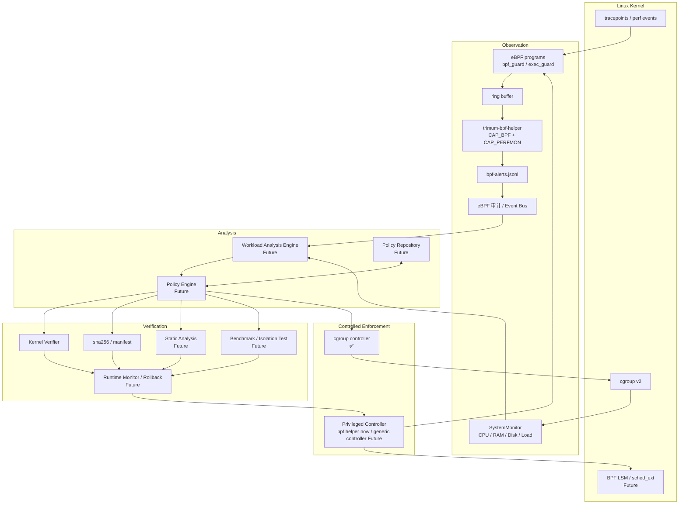
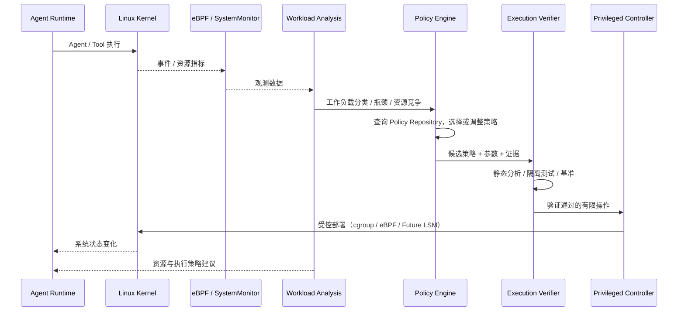

# System Intelligence 详细设计

> 归属：`docs/ARCH.md` §4。
> 本文描述 System Intelligence 的观测、分析、策略、验证与受控执行；明确区分「已实现」与「未来设计」。
> 状态记号：✅ 已实现　🟡 部分实现　⚪ 未来设计（TBD）　🚫 已废弃

---

## 1. 目标与边界

System Intelligence 的目标：让 AI 不只是调用操作系统接口，而是能理解系统运行状态，并在安全约束下辅助优化操作系统。

它包含两件事：

1. **Observation**：知道系统正在发生什么。
2. **Enforcement**：在验证之后，受控地改变系统行为。

**边界（硬约束）**：

- **LLM 推理不进入内核执行路径**。AI 分析与策略决策在用户态完成。
- **AI 不直接拥有任意内核控制权限**。内核侧只执行经过验证的有限程序；下发由受控特权组件完成。
- **未实现的强制执行不写成已实现**。当前只有 cgroup 资源控制与 eBPF 观测链路；BPF LSM / sched_ext 尚未实现。
  真机已升级到 Linux 7.0.0-31；内核配置已具备，但仍要先做能力检查与最小 PoC，
  再决定复用方式，不能把“配置为 y”当成“已实现”。

---

## 2. 总体结构



---

## 3. eBPF Observation / Enforcement

### 3.1 Observation（✅ 部分实现）

目标观测面：

- CPU、内存和 IO 负载。
- 进程与线程行为。
- 系统调用和资源访问。
- 网络活动。
- Agent 和 Tool 的执行行为。
- 系统性能事件。

当前已实现：

| 组件 | 作用 | 落点 |
|---|---|---|
| `bpf_guard.bpf.c` | 观测 `sys_enter_bpf`，记录 eBPF 相关系统调用行为 | `bpf/bpf_guard.bpf.c` |
| `exec_guard.bpf.c` | 观测 `sys_enter_execve`，记录进程执行 | `bpf/exec_guard.bpf.c` |
| 事件结构 | `struct trimum_bpf_event`，kind：`prog_load` / `bpf_attach` / `bpf_detach` / `map_write` / `exec` | `bpf/trimum_bpf.h` |
| 特权 helper | 加载 / 卸载 / 统计 / 读取事件；只接受四个动词 | `bpf_helper.py` / `bpf_helper_main.py` / `bpf_helper_protocol.py` |
| 真 loader | libbpf（ctypes）加载 `.o`，ring buffer 排水 | `bpf_loader.py` |
| daemon 侧审计 | 读回灌 JSONL → `security.ebpf_alert` | `bpf_audit.py` |
| 系统指标 | CPU / 内存 / 磁盘 / load 阈值告警 | `system_monitor.py` |

链路：

```text
bpf/*.bpf.c
  → clang 现场编译 .bpf.o（部署时 --apply）
  → trimum-bpf-helper（CAP_BPF + CAP_PERFMON，uid 门，sha256 校验）
  → ring buffer
  → /run/trimum-bpf/bpf-alerts.jsonl
  → bpf_audit.BpfAlertPoller
  → Event Bus `security.ebpf_alert` + 审计
```

**helper 的安全约束**（详见 `docs/SANDBOX-PLAN.md` §6.7）：

- 只有 `bpf.load` / `bpf.unload` / `bpf.stats` / `bpf.tail` 四个动词，**没有命令面**。
- 程序名只能取枚举值；不接受任意路径或命令字符串。
- 只加载清单登记且 sha256 对得上的 `/opt/trimum/bpf/<name>.bpf.o`。
- `CAP_BPF` + `CAP_PERFMON`，不给 `CAP_SYS_ADMIN`。
- 不监听网络、不 fork/exec、不接受 fd 传递。
- 失败一律 `ok:false`，不静默降级。

**已知约束**：

- Ubuntu 的 `CONFIG_SECURITY_PERF_EVENTS_RESTRICT=y` + `kernel.perf_event_paranoid >= 4` 时，
  `perf_event_open(2)` 需要 `CAP_SYS_ADMIN`；当前方案是把 `perf_event_paranoid` 降到 `3`
  （`/etc/sysctl.d/60-trimum-perf.conf`），**不给 helper 加 `CAP_SYS_ADMIN`**。
- `EACCES(13)` 表示内核 perf 策略拦截；`EPERM(1)` 表示 seccomp 拦截。诊断时先分这两个错误码。

**裁决（2026-11-11）**：短期保持 **A：`perf_event_paranoid=3` + 现有 tracepoint attach**。
不在这轮改纯 `bpf(2)` attach；「去掉 sysctl 依赖」作为 R2 的后备设计项，等观测基线稳定后再评估。
仍然**不给 helper 加 `CAP_SYS_ADMIN`**。

### 3.2 Enforcement（🟡 部分实现，未来扩展）

目标方向：

- cgroup 资源控制：✅ 已通过 `resource_controller.CgroupV2Controller` 落地。
- BPF LSM 安全策略：⚪ 未实现；Linux 7.0 内核配置已具备，但先做能力检查与最小 PoC，通过前不进入执行链。
- sched_ext 调度机制：⚪ 未实现；优先评估 AgentCgroup / SchedCP 等实现，不先自研内核调度器。
- 与其他内核控制接口协作：⚪ TBD。

**原则**：eBPF 不只是传感器，也可以参与受控的系统行为管理；但任何强制执行都必须经过
Policy Engine → Execution Verifier → Privileged Controller 这条链，不能由模型直接下发。

---

## 4. Workload Analysis Engine（⚪ Future Design）

### 4.1 输入

- cgroup / psutil 资源指标：CPU、RAM、IO、文件写入、网络请求。
- eBPF 事件：exec、bpf 系统调用、未来的 syscall / 网络事件。
- 审计与 Event Bus：Agent / Tool 执行记录、失败、审批、威胁事件。
- SystemMonitor 阈值告警与历史采样。

### 4.2 输出

建议的输出结构（TBD，仅示意，不是已冻结契约）：

```yaml
workload:
  id: <agent-or-workflow-id>
  class: coding | shell | browser | mcp | batch | unknown
  phase: startup | steady | burst | idle
  resources:
    cpu: {usage, pressure, trend}
    memory: {usage, pressure, trend}
    io: {read, write, pressure}
    network: {requests, bytes}
  bottlenecks: [cpu | memory | io | network | lock | unknown]
  confidence: 0.0-1.0
  evidence: [<metric/event ids>]
```

### 4.3 职责

- 识别工作负载类型与阶段。
- 发现资源竞争和性能瓶颈。
- 为 Policy Engine 提供系统状态依据。
- 不做权限裁决，不直接改系统。

### 4.4 当前状态

没有统一引擎。`system_monitor.py` 只做阈值告警；`resource_controller.py` 只做采样与限额；
`behavior_monitor.py` / `learning_engine.py` 是**安全行为**基线，不是工作负载分类器。

### 4.5 参考项目结论（2026-11-11 调研）

详细矩阵、许可证边界与落地顺序见 `docs/architecture/code-reuse.md`。这里只保留结论：

- **AgentCgroup（GPL-2.0）第一优先**：复用其 Python cgroup 生命周期、tool-call 级临时 cgroup、
  `AGENT_RESOURCE_HINT`、OOM 反馈与 JSONL metrics；不整体嵌入其 daemon。引入前核对
  `GPL-2.0-only` / `GPL-2.0-or-later`，并确认 Linux 7.0 上 `memcg_bpf_ops` 是否可用。
- **SchedCP（MIT，Rust）**：experimental / WIP，作为可选外部调度工具或 MCP 适配器，不进入核心依赖。
- **AgentSight（MIT，Rust + eBPF）**：作为可选外部观测工具；常规观测仍走 trimum 自己的事件与 SystemMonitor。
- **ActPlane（MIT，Rust + eBPF LSM）**：需要 root 或 `CAP_BPF` + `CAP_SYS_ADMIN`，与 trimum 最小权限红线冲突；
  只作设计参考，不采用其运行时。
- **依赖策略**：核心运行时保持纯 Python；不新增 Rust 工具链、第二套常驻服务或额外 root 控制器。
- **内核策略**：真机已是 Linux 7.0；先跑能力自检与最小 PoC，再决定 sched_ext / BPF LSM / memcg 的复用。

### 4.6 裁决（2026-11-11）：A 规则 / 阈值优先

trimum 的定位是**个人 AI 工作站**，不是多租户高并发平台。因此 Workload Analysis MVP 采用：

- **A 规则 / 阈值**：分类、阶段、瓶颈判断先用可解释规则 + 证据链。
- 不先做 ML 分类；等数据量、标注和回放机制成熟后再评估 B/C。
- 复用 AgentCgroup 的指标、cgroup 生命周期与反馈模式；SchedCP / AgentSight 只作为可选外部工具或设计参考。

---

## 5. Policy Repository（⚪ Future Design）

### 5.1 目标

沉淀可复用的系统策略，避免每次都让模型从零生成：

- 已有调度策略。
- eBPF 程序和调度器。
- 工作负载特征。
- 策略适用条件。
- 历史执行结果。
- 性能测试数据。

### 5.2 条目结构（2026-11-11 定：A Git 版本化 YAML）

```yaml
id: sched.burst.coding.v1
kind: scheduler | ebpf_program | cgroup_profile | lsm_policy
applies_to:
  workload_class: coding
  phase: burst
  kernel: ">=7.0"
  prerequisites: [cgroup_v2, bpf_perfmon]
program:
  source: bpf/xxx.bpf.c
  sha256: <hash>
params:
  cpu_weight: ...
evidence:
  benchmark: <result id>
  history: [<run ids>]
provenance:
  author: human | ai-assisted
  verified_by: <verifier run id>
  created_at: <date>
```

### 5.3 原则

- **复用优先**：先查仓库，再调整参数，最后才考虑生成新策略。
- **来源可追溯**：每条策略记录作者、验证记录、适用条件与历史结果。
- **不把仓库当垃圾场**：验证失败或长期无收益的策略应标记 / 淘汰（机制 TBD）。

### 5.4 当前状态

现有 `config/policy.yaml`、威胁剧本、eBPF 程序清单是**前身**，不是完整策略仓库。

### 5.5 裁决（2026-11-11）：A Git 版本化 YAML

trimum 是个人 AI 工作站，策略量级与并发都不高，因此：

- **策略真源 = Git 里的 YAML 文件**；评审、diff、回滚都走 Git。
- 不先引入 SQLite 索引；等策略数量或查询需求真的增长，再考虑 YAML + SQLite 索引（C）。
- 运行时只读策略文件；写入必须走显式导入 / 提交，不在热路径动态改仓库。
- 每条策略必须有 `id` / `version` / `applies_to` / `evidence` / `provenance`，便于审计与淘汰。

---

## 6. Policy Engine（⚪ Future Design）

职责：

- 根据工作负载分析选择策略。
- 调整已有策略参数。
- 必要时修改或组合已有策略。
- 在适当情况下生成新策略。
- 根据系统反馈进行策略优化。

**与现有 `policy_engine.py` 的区别**：

| 名称 | 作用域 | 现状 |
|---|---|---|
| `policy_engine.py` | Agent Runtime 安全策略：allow / confirm / deny | ✅ 已实现 |
| System Intelligence Policy Engine | 系统调度 / 资源 / eBPF 策略选择 | ⚪ Future |

两者不要混名。本文的 Policy Engine 不直接执行系统操作，只产出「候选策略 + 参数 + 理由 + 证据」。

### 6.1 裁决（2026-11-11）：B AI 提议 + 人工审批 + 强制验证

- AI 可以提议新策略或参数调整，但**不能直接部署**。
- 提议必须落成一条候选策略，附带理由、证据、适用条件。
- 人工审批后才进入 Execution Verifier；验证失败一律拒绝。
- 不采用 C（自动生成 + 自动部署）；那会绕过 fail-safe 边界。

---

## 7. Execution Verifier

### 7.1 职责

- eBPF Verifier 检查。
- 静态分析。
- 运行前验证。
- 隔离环境测试。
- 性能基准测试。
- 部署前策略检查。
- 运行时监控。
- 异常熔断和策略回滚。

### 7.2 硬约束

- AI 生成的内核策略**绝不能未经验证直接部署**。
- 验证失败一律拒绝；不因为「看起来没问题」放行。
- 验证记录必须可追溯（策略 ID、程序 sha256、测试环境、结果）。

### 7.3 当前状态

| 能力 | 状态 | 说明 |
|---|---|---|
| 内核 eBPF verifier | ✅ | 由内核执行；加载失败即拒绝 |
| 程序 sha256 清单校验 | ✅ | `bpf_helper_protocol` / `apply_ebpf1e.sh` |
| uid 门与能力最小化 | ✅ | `SO_PEERCRED` + `CAP_BPF/CAP_PERFMON` |
| 沙箱隔离测试 | ✅ | Landlock / seccomp / cgroup |
| 静态分析 | ⚪ | 没有专门的分析管线 |
| 性能基准 | ⚪ | 没有自动基准框架 |
| 运行时熔断 / 自动回滚 | ⚪ | 只有失败拒绝与人工回滚脚本 |

---

## 8. Privileged Controller

### 8.1 原则

- AI 不直接拥有任意内核控制权限。
- 由受控的用户态特权组件执行**有限的、经过授权的**系统操作。
- 控制器不接受命令字符串，只接受白名单动词与受限参数。
- 控制器失败必须显式返回，不静默降级。

### 8.2 当前实现：trimum-bpf-helper（🟡）

- 动词：`bpf.load` / `bpf.unload` / `bpf.stats` / `bpf.tail`。
- 能力：`CAP_BPF` + `CAP_PERFMON`，无 `CAP_SYS_ADMIN`。
- 认证：Unix socket + `SO_PEERCRED` + 白名单 uid。
- 程序来源：`/opt/trimum/bpf/<枚举名>.bpf.o`，sha256 清单校验。
- 运行目录：`/run/trimum-bpf`（与 `trmd` 的 `/run/trimum` 分离）。
- 数据流：单向回灌到 JSONL，daemon 侧审计。

它**不是**通用内核控制器：不能执行任意 eBPF 程序、不能写任意内核参数、不能代替 root。

### 8.3 裁决（2026-11-11）：C 先不拆，靠人类审批顶着

- 暂时**不扩展** `trimum-bpf-helper`，也**不另起**独立 controller。
- 新的受控操作先由人类审批 + 现有最小权限组件执行；不做自动下发。
- 人类审批是**额外闸门**，不是最小权限的替代品：helper 的能力集、动词白名单、sha256 校验仍然必须保留。
- 等出现明确需求（例如 sched_ext / memcg 操作）再评估「扩展 helper」还是「按域拆 controller」。

---

## 9. 反馈闭环



闭环的三个共同维度：

1. **资源管理**：Runtime 提需求，System Intelligence 观察全局竞争并建议调整。
2. **安全治理**：Runtime 管沙箱与工具权限，System Intelligence 管系统级策略与受控执行。
3. **动态控制**：Runtime 根据反馈调整后续任务的资源需求与执行方式。

**裁决（2026-11-11）**：反馈闭环**先等 R1 / R2 / R4 稳定**，不在当前 MVP 里做自动反馈控制。
先把观测、规则分析、人工审批跑通；闭环的传输方式与频率以后再定。

---

## 10. 当前实现边界（汇总）

| 能力 | 状态 | 备注 |
|---|---|---|
| eBPF 观测链路 | ✅ | helper + loader + 审计回灌，真机已跑通 |
| cgroup 资源控制 | ✅ | Agent 级预算 |
| SystemMonitor 阈值告警 | ✅ | CPU / 内存 / 磁盘 / load |
| 工作负载分类 / 瓶颈分析 | ⚪ | 无统一引擎；已定 A 规则优先 |
| Policy Repository | ⚪ | 已定 A Git 版本化 YAML；待实现 |
| 调度策略选择 / 参数调整 / 生成 | ⚪ | 无实现 |
| 静态分析 / 基准 / 自动回滚 | ⚪ | 无实现 |
| BPF LSM / sched_ext | ⚪ | 目标 Linux 7.0；升级后做能力检查、复用评估与 PoC，不阻塞 MVP |
| 通用 Privileged Controller | ⚪ | 已定 C 冻结现状，人类审批顶着 |

---

## 11. 已裁决与剩余 TBD（2026-11-11）

### 11.1 已裁决

| 决策 | 结论 |
|---|---|
| 内核基线 | **Linux 7.0.0-31-generic**（2026-11-22 已升级）；sched_ext / BPF LSM / memcg 仍需能力自检与最小 PoC。 |
| 外部复用 | **AgentCgroup 第一优先**；SchedCP / AgentSight 可选外部；ActPlane 只作设计参考。 |
| eBPF perf gate | **A 短期保持 `perf_event_paranoid=3`**；纯 `bpf(2)` attach 作为后备设计项。 |
| 审计链刷屏 | **先诊断（D）**；确认是密钥轮换/归档残留再隔离旧链 + 新链（C）；疑似篡改则保留证据、人工裁决。 |
| Workload Analysis | **A 规则 / 阈值优先**；复用 AgentCgroup / SchedCP / AgentSight 的指标与事件设计，不整体嵌入其运行时。 |
| Policy Repository | **A Git 版本化 YAML**；不先上 SQLite。 |
| 策略生成 | **B AI 提议 + 人工审批 + 强制验证**；不允许自动部署。 |
| Privileged Controller | **C 先不拆**：不扩 helper、不另起 controller；人类审批顶着。 |
| 反馈闭环 | **暂缓**：等 R1 / R2 / R4 稳定后再做。 |

### 11.2 剩余 TBD

1. 工作负载分析的输入/输出 schema 与采样频率。
2. 指标来源优先级：eBPF、cgroup、psutil、审计事件如何合并。
3. Policy Repository 的条目签名与淘汰机制（存储形态已定 A）。
4. Execution Verifier 的验证等级与准入清单。
5. Linux 7.0 上 sched_ext / BPF LSM / memcg_bpf_ops 的实际能力与 PoC 准入（见下方说明）。
6. 运行时熔断、回滚与人工接管流程。
7. 如何避免观测开销影响业务（采样、聚合、背压）。

**关于 PoC**：PoC（Proof of Concept，概念验证）是用最小代价验证「这条路是否走得通」，
不是生产实现。例如：写一个最小 sched_ext 程序，在支持的内核上加载、跑一组固定负载、记录吞吐/延迟，
看是否值得继续。PoC 成功 ≠ 可上线；之后还要设计、验证、回滚。真机已是 Linux 7.0，
sched_ext 的版本与内核配置门槛已满足，但加载权限、实际稳定性与回滚仍需逐项验证；PoC 不阻塞 MVP。

---

## 12. 一句话

> System Intelligence 不是「让 AI 直接改内核」，而是「让 AI 在可观测、可验证、可回滚的约束下，
> 辅助系统做出更好的资源与执行决策」。
